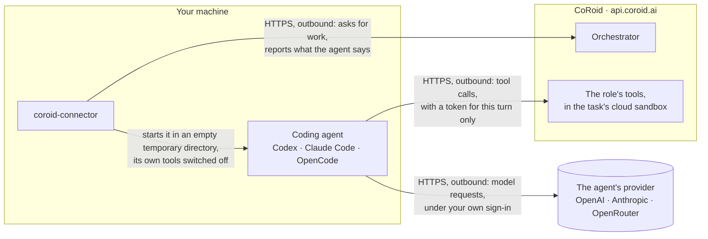
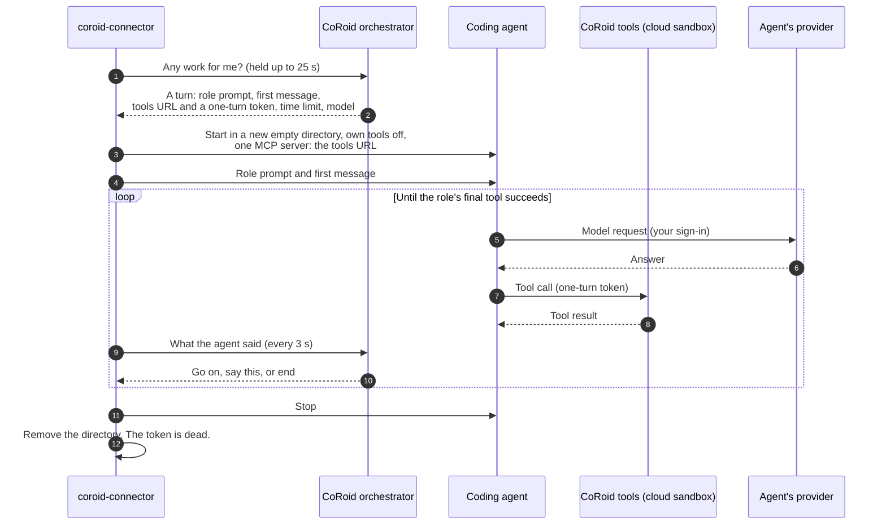

# CoRoid connector

The CoRoid connector lets the coding agents on your own machine (Codex,
Claude Code, OpenCode) do work [CoRoid](https://coroid.ai) assigns to them,
on your own subscription. The agent does a role's reasoning on your machine;
CoRoid gives it that role's tools and keeps the rest of the workflow: the
task, the checks, the record of what happened.

This repository is the connector's complete source. Every release is built
from a tagged commit here by GitHub Actions, attested, and published to npm
with provenance, so you can check that what you install is what this source
builds. Nothing here is a copy of anything you cannot read.

## How it works



- **Outbound only.** The connector opens no port, except for a moment on
  `127.0.0.1` while you sign in. It asks CoRoid for work over HTTPS; a request
  is held for up to 25 seconds and then asked again, which is also how CoRoid
  knows the machine is connected.
- **Your code stays in CoRoid.** The repository is never copied to your
  machine. The agent's tools (read a file, run the tests, apply a change) run
  in the task's sandbox in CoRoid; what reaches your machine is what those
  tools return, such as the contents of a file the agent reads or the output
  of a test run.
- **The agent's own tools are off.** Each agent is started with its own switch
  for this (below), and the connector refuses any permission request that is
  not a call to CoRoid's tools for the turn.
- **Your sign-in to the agent stays yours.** The agent signs in to its
  provider as it does without CoRoid. CoRoid never sees that sign-in, and the
  model usage is on your plan.

### A turn, step by step



A turn is offered to your machine only when **you** started the task, a role
of your organization's AI profile is assigned to an agent, and your machine is
connected. Otherwise the role runs on the cloud model the profile names for it.

## Install

```sh
brew install coroid-ai/tap/coroid-connector      # macOS and Linux
npm install --global @coroid/connector           # anywhere with Node 20 or newer
```

Then add the agents you use, and start it:

```sh
coroid-connector add codex      # or: add claude. OpenCode needs no adding.
coroid-connector                # signs in once, in your browser, then stays connected
```

`add` installs the agent's ACP adapter, which brings its own copy of the agent
(about 350 MB), into `~/.coroid/connector/agents`. It installs exactly the
packages the release's lockfile names (`src/adapters/<agent>/package-lock.json`,
every package pinned by version and SHA-512) with `npm ci --ignore-scripts`.
Nothing is downloaded when the connector runs.

## Verify a release

Each release on GitHub carries the published package, the connector file, a
CycloneDX bill of materials and `SHA256SUMS`, and is attested by the workflow
that built it:

```sh
npm view @coroid/connector@<version> dist.attestations   # npm's provenance
gh attestation verify coroid-connector-<version>.tgz --repo COROID-AI/coroid-connector
```

The attestation names the commit and the workflow run that built the file.

## What the connector does and does not do

It does:

- sign in with OAuth 2.1 and PKCE in your browser, for one scope
  (`connector.turns`) at `https://api.coroid.ai/connector`. The access token
  lasts 15 minutes; the refresh token 30 days and is replaced at every use.
  Disconnecting the machine in CoRoid revokes them. They are kept in the
  macOS keychain, or the Secret Service of a Linux desktop session; only where
  there is neither, in a file only you can read. They are handed to those
  tools on standard input, never on a command line. `coroid-connector status`
  says where yours are;
- tell CoRoid, with its first request, the machine's name (its host name, or
  `--name`), the operating system, its own version, and each agent's version,
  state and the models it offers;
- start an agent for a turn, relay what it says, answer its permission
  requests (yes only to CoRoid's tools for that turn), and stop it.

It does not:

- read or send any file of your machine, run a command of its own, or let the
  agent use its shell, editor, web search, MCP servers or connectors;
- open a port others can reach, or take instructions from anyone but CoRoid
  over the connection it opened;
- download anything when it runs.

### Each agent's own tools, switched off

| Agent | How |
| --- | --- |
| Codex | `CODEX_CONFIG`: the shell, unified exec, apps, plugins, multi-agent, image, browser and computer-use features off, web search disabled; session mode `read-only` |
| Claude Code | Session options: no tools of its own, no MCP configuration but the turn's, none of your settings, no session transcript; mode `default` |
| OpenCode | An `opencode.jsonc` in the turn's directory that denies every action except the tools of the turn's MCP server |

A switch belongs to the versions it was tried on: the connector uses only the
adapter versions its lockfiles pin, and an agent on another version is shown
and not used.

### What stays on your machine

The connector removes each turn's directory. What an agent keeps in its own
storage depends on the agent:

| Agent | What it keeps of a turn |
| --- | --- |
| Claude Code | No transcript |
| Codex | A transcript in `~/.codex/sessions`, including the files it read |
| OpenCode | Its session in its own database under `~/.local/share/opencode` |

The connector's own state is in `~/.coroid/connector` (readable only by you):
the sign-in (its tokens in the credential store, where there is one) and the
added adapters.

## Security

See [SECURITY.md](./SECURITY.md) to report a vulnerability.

## Development

The connector is developed in CoRoid's main repository, where it is tested
against CoRoid's own server code, and exported here for every release. Issues
and pull requests are welcome here; a change that is accepted goes in through
the main repository and comes back with the next export. Comments that name a
plan ("Plan 47 Phase 4", "Plan 48a") point to CoRoid's internal design
records; each says in place what it decided.

```sh
npm ci
npm test
npm run build      # dist/coroid-connector.mjs
```

## License

Apache License 2.0. Copyright 2026 CoNeuroid AB. See [LICENSE](./LICENSE) and
[NOTICE](./NOTICE).
